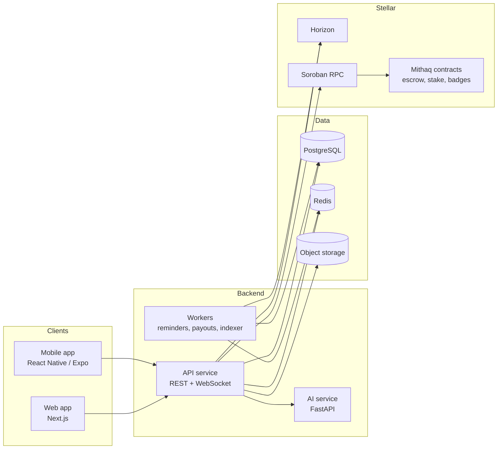

# 💍 Mithaq

**A halal-first Muslim matchmaking platform built on the Stellar network.**

Mithaq (ميثاق, "the solemn covenant", the Quranic word for marriage in 4:21) helps Muslims find a serious spouse in a way that respects Islamic etiquette, family involvement and trust. Users match on deen and values, chat only after mutual acceptance, pay and tip in XLM or USDC, and can lock a mahr pledge in an on-chain escrow that is released at the nikah.

> **Status:** 🚧 Early development. This README describes the target architecture and feature set. Items are marked ✅ done, 🛠️ in progress or 🗓️ planned in the [Roadmap](#-roadmap).

---

## 📑 Table of Contents

- [Why Mithaq](#-why-mithaq)
- [Features](#-features)
- [How It Works](#-how-it-works)
- [Architecture](#-architecture)
- [Monorepo Structure](#-monorepo-structure)
- [Tech Stack](#-tech-stack)
- [Stellar Integration](#-stellar-integration)
- [Smart Contracts](#-smart-contracts)
- [Getting Started](#-getting-started)
- [Environment Variables](#-environment-variables)
- [Scripts](#-scripts)
- [API Overview](#-api-overview)
- [AI Assistant](#-ai-assistant)
- [Safety, Privacy and Moderation](#-safety-privacy-and-moderation)
- [Testing](#-testing)
- [Deployment](#-deployment)
- [Roadmap](#-roadmap)
- [Contributing](#-contributing)
- [Disclaimer](#-disclaimer)
- [License](#-license)

---

## 🌙 Why Mithaq

Most dating apps aren't designed for Muslims looking for marriage. They ignore the role of the family, encourage casual interaction and give users no way to show they are serious. Mithaq is built around three ideas:

1. **Intent over browsing.** Users match on deen, values and life goals, and prove they are serious.
2. **Family-aware by design.** A wali (guardian) or trusted family member can take part in the process.
3. **Trust through transparency.** Stellar gives us low-fee payments, non-custodial wallets and escrow, so money-related commitments are verifiable instead of promised.

---

## ✨ Features

### Core

| Feature | Description |
|---|---|
| **Sign up and profile** | Email or wallet sign-up, profile with deen details (madhhab, prayer habits, hijab/beard preference), marriage goals and photos |
| **Matching** | Browse and filter matches by deen, location, age, education and family goals, with a compatibility score |
| **Chat** | Opens only after a mutual match; limits, reporting and AI moderation built in |
| **Wallet** | Send and receive **XLM** and **USDC** inside the app |
| **Subscriptions** | Pay for premium plans in **XLM or USDC**, with on-chain payment verification |
| **Daily Islamic reminders** | A daily ayah, hadith or dua delivered by push or email |
| **Islamic quiz and rewards** | Answer questions correctly and earn **XLM** rewards; streaks and leaderboards |
| **Social feed** | Share experiences, post, like, comment and follow in a "tweet-style" feed |
| **AI support assistant** | Helps users fix sign-up problems and subscription issues |

### What makes Mithaq different

| Feature | Description |
|---|---|
| 🛡️ **Wali / Guardian Mode** | A user can invite a wali or family member to view matches (read-only) or approve introductions before a chat opens |
| 💰 **Nikah Escrow** | Lock a mahr pledge on-chain; it is released at the agreed nikah date, or returned if both parties cancel |
| ✅ **Verified Intent Badge** | A small refundable USDC stake that signals seriousness; returned after a period, or slashed for confirmed abuse |
| 🕊️ **Halal-by-design chat** | Mutual-accept only, optional chaperone mode, message limits and AI content flagging |
| 🧭 **Deen-based compatibility** | Matching weights prayer consistency, madhhab, family goals and values, not just looks |
| 🏅 **On-chain reputation badges** | Non-transferable badges for verified ID, quiz streaks and positive conduct |
| 👨‍👩‍👧 **Family Intro Pack** | A privacy-controlled, shareable summary for parents or a wali, viewable by link |
| 🤲 **Sadaqah round-ups** | An optional share of subscriptions goes to a transparent charity pool |

---

## 🔄 How It Works

```
Sign up ──► Build profile ──► Get matches ──► Mutual accept ──► Chat
                │                                   │
                │                          (optional) Wali approves
                ▼
        Verified Intent stake                 Agree to proceed
        (refundable USDC)                          │
                                                   ▼
                                       Nikah Escrow (mahr pledge)
                                                   │
                                      Released at nikah date, or
                                      refunded on mutual cancel
```

Alongside this core flow, users can read daily reminders, take quizzes to earn XLM, and post in the community feed.

---

## 🏗️ Architecture



**Design principles**

- **Non-custodial first.** Users hold their own keys. The backend never sees a user's secret key.
- **The chain is the source of truth for money.** Payments and escrow state are confirmed from Stellar, not from client claims.
- **Privacy by default.** Photos, messages and wali access are permission-gated.
- **Fail safe.** The AI assistant and quiz payouts degrade gracefully and never block core flows.

---

## 📁 Monorepo Structure

The repo is managed with **pnpm workspaces** and **Turborepo**.

```
mithaq/
├── apps/
│   ├── web/                 # Next.js web application
│   ├── mobile/              # React Native (Expo) app
│   ├── api/                 # REST + WebSocket backend (NestJS)
│   └── ai/                  # FastAPI AI assistant service
│
├── contracts/               # Soroban smart contracts (Rust)
│   ├── nikah-escrow/        # Mahr pledge escrow
│   ├── intent-stake/        # Verified Intent stake and slashing
│   └── badges/              # Non-transferable reputation badges
│
├── packages/
│   ├── ui/                  # Shared React component library
│   ├── sdk/                 # Typed API client and Stellar helpers
│   ├── types/               # Shared TypeScript types and schemas
│   ├── config/              # Shared ESLint, TS and Tailwind configs
│   └── content/             # Quiz bank, daily reminders (reviewed content)
│
├── infra/
│   ├── docker/              # Dockerfiles and compose files
│   └── ci/                  # CI/CD workflows and scripts
│
├── docs/                    # Architecture notes, ADRs, API docs
├── scripts/                 # Dev and ops scripts (seed, fund testnet, etc.)
├── .env.example
├── package.json
├── pnpm-workspace.yaml
├── turbo.json
└── README.md
```

---

## 🧰 Tech Stack

| Layer | Technology |
|---|---|
| **Web** | Next.js (App Router), TypeScript, Tailwind CSS |
| **Mobile** | React Native (Expo), TypeScript |
| **API** | NestJS (Node.js), TypeScript, WebSockets |
| **AI service** | Python 3.11+, FastAPI, Google Gemini |
| **Database** | PostgreSQL (Prisma ORM) |
| **Cache / queues** | Redis, BullMQ |
| **Storage** | S3-compatible object storage |
| **Blockchain** | Stellar (Horizon + Soroban), `@stellar/stellar-sdk` |
| **Contracts** | Rust, Soroban SDK |
| **Wallets** | Freighter, Lobstr and other Stellar wallets (SEP-7 / wallet kit) |
| **Tooling** | pnpm, Turborepo, ESLint, Prettier, Vitest, Playwright, GitHub Actions |

> The stack above is the intended default. Swap pieces as the project evolves.

---

## ⭐ Stellar Integration

| Use case | How it works |
|---|---|
| **Send and receive XLM / USDC** | Users sign payments with their own wallet; the app builds the transaction and displays the confirmed result |
| **Subscriptions** | The user pays a unique address or memo; a worker watches Horizon for matching payments and activates the plan after confirmation |
| **Quiz rewards** | The backend validates answers server-side and pays XLM from a funded rewards account, with per-user daily caps |
| **Nikah Escrow** | A Soroban contract (or claimable balance) holds the pledge until release conditions are met |
| **Verified Intent stake** | A refundable USDC deposit held by a contract, released after the lock period or slashed on a moderator-confirmed violation |
| **Badges** | Non-transferable on-chain records of verified status and conduct |
| **Charity round-ups** | A fixed share of subscription payments is sent to a public sadaqah account |

**Networks.** Develop and test on **Stellar testnet**. Switch to **public** by changing `STELLAR_NETWORK`.

**USDC.** Always use Circle's official USDC issuer for the network you are on, and set it in `.env`. Do not hardcode asset issuers in application code.

**Key handling rules**

- Users' secret keys and seed phrases are never requested, stored or logged.
- The rewards and escrow-admin keys live only in a secrets manager, never in the repo.
- All amounts use decimal or integer arithmetic (stroops), never floats.

---

## 📜 Smart Contracts

Contracts live in `contracts/` and are written in Rust for Soroban.

### `nikah-escrow`
Holds a mahr pledge between two parties.

- `create(payer, payee, asset, amount, release_date)`
- `release()` pays the payee once the release date is reached and the release condition is met
- `cancel()` returns funds if both parties approve, or on expiry rules
- Emits events for every state change, indexed by the worker

### `intent-stake`
Manages the Verified Intent deposit.

- `stake(user, amount)`, `unstake(user)` after the lock period
- `slash(user, reason)` callable only by the authorized moderation role, with an on-chain reason code
- Slashed funds go to a defined destination (for example, the sadaqah pool)

### `badges`
Non-transferable reputation records.

- `award(user, badge_id)` callable only by the admin or a verifier role
- `has_badge(user, badge_id)` read-only check used by the app

**Build and test**

```bash
cd contracts/nikah-escrow
cargo test
stellar contract build
```

> ⚠️ Contracts handle real funds. Get an independent audit before any mainnet deployment.

---

## 🚀 Getting Started

### Prerequisites

- **Node.js** 20+
- **pnpm** 9+
- **Python** 3.11+ (for `apps/ai`)
- **Rust** and the **Stellar CLI** (for `contracts/`)
- **Docker** (for local PostgreSQL and Redis)
- A **Google Gemini API key** (for the AI assistant)

### Setup

```bash
# 1. Clone
git clone https://github.com/<your-org>/mithaq.git
cd mithaq

# 2. Install JS dependencies for all workspaces
pnpm install

# 3. Configure environment
cp .env.example .env
# then fill in the values (see Environment Variables)

# 4. Start PostgreSQL and Redis
docker compose -f infra/docker/docker-compose.dev.yml up -d

# 5. Run database migrations and seed data
pnpm --filter api db:migrate
pnpm --filter api db:seed

# 6. Set up the AI service
cd apps/ai
python -m venv venv
source venv/bin/activate        # Windows: venv\Scripts\activate
pip install -r requirements.txt
cd ../..

# 7. Fund testnet accounts (rewards pool, escrow admin)
pnpm run stellar:fund-testnet

# 8. Start everything
pnpm dev
```

| Service | URL |
|---|---|
| Web app | http://localhost:3000 |
| API | http://localhost:4000 |
| API docs | http://localhost:4000/docs |
| AI service | http://localhost:8000 |
| AI docs | http://localhost:8000/docs |

---

## 🔐 Environment Variables

Copy `.env.example` to `.env`. Never commit real secrets.

### Shared / Stellar

| Variable | Description | Example |
|---|---|---|
| `STELLAR_NETWORK` | `testnet` or `public` | `testnet` |
| `HORIZON_URL` | Horizon endpoint | `https://horizon-testnet.stellar.org` |
| `SOROBAN_RPC_URL` | Soroban RPC endpoint | `https://soroban-testnet.stellar.org` |
| `USDC_ISSUER` | Official USDC issuer for the chosen network | (verify with Circle docs) |
| `REWARDS_SECRET_KEY` | Secret key of the quiz rewards account | server only |
| `REWARDS_DAILY_CAP_XLM` | Max XLM a user can earn per day | `5` |
| `SUBSCRIPTION_RECEIVER` | Public key that receives subscription payments | `G...` |
| `SADAQAH_ACCOUNT` | Public key of the charity pool | `G...` |
| `ESCROW_CONTRACT_ID` | Deployed `nikah-escrow` contract ID | `C...` |
| `STAKE_CONTRACT_ID` | Deployed `intent-stake` contract ID | `C...` |
| `BADGES_CONTRACT_ID` | Deployed `badges` contract ID | `C...` |

### API

| Variable | Description |
|---|---|
| `DATABASE_URL` | PostgreSQL connection string |
| `REDIS_URL` | Redis connection string |
| `JWT_SECRET` | Secret for signing session tokens |
| `S3_BUCKET`, `S3_REGION`, `S3_ACCESS_KEY`, `S3_SECRET_KEY` | Object storage for photos |
| `AI_SERVICE_URL` | URL of the AI service |
| `AI_SERVICE_API_KEY` | Shared key sent as `X-API-Key` to the AI service |
| `EMAIL_PROVIDER_API_KEY` | For verification emails and reminders |
| `PUSH_PROVIDER_KEY` | For push notifications |

### AI service

| Variable | Description | Default |
|---|---|---|
| `GEMINI_API_KEY` | Google Gemini API key | none |
| `SERVICE_API_KEY` | Required key for incoming requests | none |
| `MODEL_NAME` | Gemini model to use | `gemini-1.5-flash` |
| `AUTH_DISABLED` | Skip auth for local development only | `false` |

### Web / Mobile

| Variable | Description |
|---|---|
| `NEXT_PUBLIC_API_URL` | Public API base URL |
| `NEXT_PUBLIC_STELLAR_NETWORK` | Network shown and used by the wallet connector |

---

## 🧪 Scripts

Run from the repo root.

| Command | Description |
|---|---|
| `pnpm dev` | Start all apps in watch mode |
| `pnpm build` | Build all apps and packages |
| `pnpm lint` | Lint all workspaces |
| `pnpm typecheck` | Type-check all workspaces |
| `pnpm test` | Run unit tests across the monorepo |
| `pnpm test:e2e` | Run Playwright end-to-end tests |
| `pnpm --filter <name> <script>` | Run a script in one workspace |
| `pnpm run stellar:fund-testnet` | Create and fund testnet accounts via Friendbot |
| `pnpm run contracts:build` | Build all Soroban contracts |
| `pnpm run contracts:test` | Run all contract tests |

---

## 🔗 API Overview

Full interactive docs are served at `/docs`. A high-level map:

| Area | Example routes |
|---|---|
| **Auth** | `POST /auth/signup`, `POST /auth/login`, `POST /auth/wallet/challenge` |
| **Profiles** | `GET /profiles/me`, `PUT /profiles/me`, `POST /profiles/me/photos` |
| **Matching** | `GET /matches/suggestions`, `POST /matches/:id/accept`, `POST /matches/:id/decline` |
| **Chat** | `GET /chats`, `GET /chats/:id/messages`, WebSocket `/ws` |
| **Wali mode** | `POST /wali/invite`, `POST /wali/approvals/:id`, `GET /wali/view` |
| **Wallet** | `POST /payments/build`, `GET /payments/history` |
| **Subscriptions** | `GET /plans`, `POST /subscriptions/checkout`, `GET /subscriptions/status` |
| **Escrow** | `POST /escrow`, `GET /escrow/:id`, `POST /escrow/:id/release`, `POST /escrow/:id/cancel` |
| **Intent stake** | `POST /stake`, `POST /stake/unstake`, `GET /stake/status` |
| **Quiz** | `GET /quiz/next`, `POST /quiz/answer`, `GET /quiz/leaderboard` |
| **Reminders** | `GET /reminders/today`, `PUT /reminders/preferences` |
| **Feed** | `GET /feed`, `POST /posts`, `POST /posts/:id/like`, `POST /posts/:id/comments` |
| **Moderation** | `POST /reports`, `POST /blocks` |
| **Support (AI)** | `POST /support/chat` |

All authenticated routes expect `Authorization: Bearer <token>`. The AI service additionally requires an `X-API-Key` header.

---

## 🤖 AI Assistant

The AI service (`apps/ai`) is a FastAPI app that wraps Gemini with a Mithaq-specific system prompt.

**What it does**

- Helps users fix **sign-up problems** (verification emails, wallet connection, profile errors)
- Helps with **subscription issues** (pending payments, wrong memo, plan not activated)
- Suggests respectful conversation starters and explains basic marriage etiquette

**What it does not do**

- It does not give religious rulings (fatwa). It points users to qualified scholars.
- It never asks for, accepts or repeats a secret key or seed phrase. If a message looks like one, it refuses and tells the user to treat the key as compromised.
- It never signs or submits Stellar transactions.

**Safety**

- Input and output are checked by a content-safety layer.
- Account-specific answers (subscription state, payment status) come from the API, not from the model's memory.
- Responses with account data are never cached.

---

## 🛡️ Safety, Privacy and Moderation

| Area | Approach |
|---|---|
| **Mutual consent** | Chat opens only after both users accept |
| **Wali controls** | Access is invited, scoped and revocable at any time by the user |
| **Photo privacy** | Option to blur or hide photos until a mutual match |
| **Reporting and blocking** | In-app reporting on profiles, posts and messages, reviewed by moderators |
| **AI moderation** | Messages and posts are screened for harassment, explicit content and scams |
| **Anti-scam** | Rate limits, new-account restrictions and warnings about off-platform requests |
| **Slashing safeguards** | Stake slashing requires a documented moderator decision and an appeal path |
| **Data protection** | Encryption in transit and at rest; minimal data retention; account deletion on request |
| **Rewards abuse** | Server-side answer validation, daily caps, rate limits and duplicate-account checks |

---

## ✅ Testing

```bash
pnpm test              # unit and integration tests
pnpm test:e2e          # end-to-end (Playwright)
pnpm run contracts:test   # Soroban contract tests
cd apps/ai && pytest -q   # AI service tests
```

- Contracts are tested against Soroban's local test environment, and critical flows are rehearsed on testnet.
- Payment and subscription logic is tested with mocked Horizon responses and testnet runs.
- Stellar-related code must have tests for failure cases (wrong asset, wrong memo, underpayment, duplicate payment).

---

## ☁️ Deployment

| Component | Suggested target |
|---|---|
| `apps/web` | Vercel |
| `apps/api`, `apps/ai` | Render, Fly.io or any Docker host |
| PostgreSQL / Redis | Managed services |
| Contracts | Stellar testnet first, then mainnet after audit |

CI (GitHub Actions) runs lint, type-checks, tests and contract builds on every pull request. Deploys happen from `main` after checks pass.

**Pre-mainnet checklist**

- [ ] Independent smart contract audit
- [ ] Secrets in a managed secrets store; rotate all keys
- [ ] Rewards account funded with a limited balance only
- [ ] Moderation team and appeals process in place
- [ ] Privacy policy and terms published
- [ ] Legal review of payments and stake/slashing terms in target regions

---

## 🗺️ Roadmap

**Phase 1: Foundation (MVP)**
- 🛠️ Sign-up, profiles, matching
- 🛠️ Mutual-accept chat
- 🗓️ XLM / USDC send and receive
- 🗓️ Subscriptions via XLM / USDC
- 🗓️ Daily Islamic reminders

**Phase 2: Community and engagement**
- 🗓️ Quiz with XLM rewards
- 🗓️ Social feed (posts, likes, comments)
- 🗓️ AI support assistant

**Phase 3: Trust and commitment**
- 🗓️ Wali / Guardian Mode
- 🗓️ Verified Intent stake
- 🗓️ Nikah Escrow
- 🗓️ Reputation badges

**Phase 4: Growth**
- 🗓️ Family Intro Packs
- 🗓️ Sadaqah round-ups
- 🗓️ Mobile apps release
- 🗓️ Contract audit and mainnet launch

---

## 🤝 Contributing

Contributions are welcome.

1. Fork the repo and create a branch from `dev`: `git checkout -b feat/your-feature`
2. Make your changes and add tests
3. Run `pnpm lint && pnpm typecheck && pnpm test`
4. Open a pull request against `dev` with a clear description

**Guidelines**

- Follow the existing code style (ESLint and Prettier run in CI).
- Use [Conventional Commits](https://www.conventionalcommits.org/) (`feat:`, `fix:`, `docs:`).
- Claim an issue by commenting on it before you start.
- Never commit secrets, real user data or private keys.
- Islamic content (quiz questions, reminders) must cite its source and be reviewed before merging.

See `CONTRIBUTING.md` for details.

---

## ⚠️ Disclaimer

- Mithaq is a technology platform that connects people. It does **not** conduct, validate or guarantee any marriage.
- Content in the app, including reminders, quizzes and AI replies, is for general education and is **not** a religious ruling. Consult a qualified scholar for fatwa and personal religious matters.
- Escrow, staking and rewards involve real digital assets on mainnet. Use testnet while developing, and understand the terms before using mainnet features.
- Nothing here is financial or legal advice.

---

## 📜 License

Released under the [MIT License](LICENSE).

---

<p align="center">
  <i>"And among His signs is that He created for you spouses from among yourselves, that you may find tranquility in them, and He placed between you affection and mercy."</i><br/>
  <b>Quran 30:21</b>
</p>